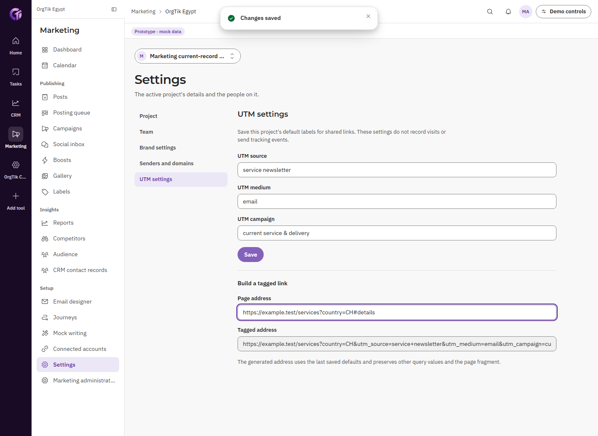
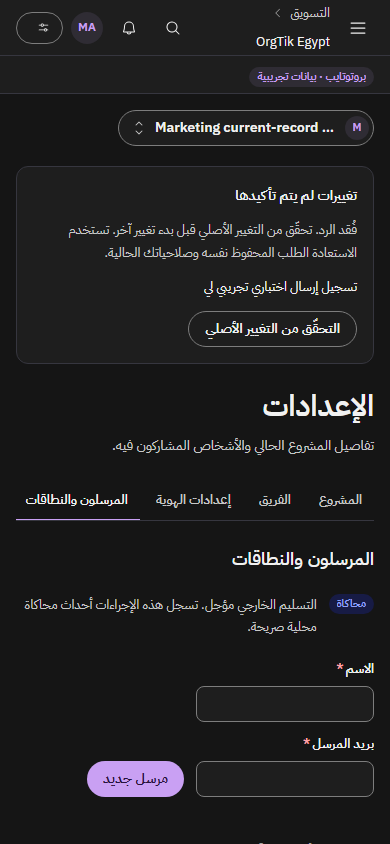

# Marketing P4 native acceptance

Marketing's adopted Tier A/B work is complete in the bounded local prototype. The ordinary screens save and read owner-domain records; connected CRM and Tasks controls use current access, canonical references, native operations, and exact destination records. The final source is `7282bfccdb6cc8b20f50f05876e5388ae0afd8f7`, following recovery checkpoint `81ba1196bb9791277e889f9b30db339a2d1688d3`.

[acceptance.json](acceptance.json) records the exact source hashes, accepted report files, and capture inventory. It contains **1,927 browser assertions, 504 unique accepted captures, and 22 passing tests** (19 native domain/runtime cases and three client command cases). These aggregate assertions do not stand for independent backlog criteria.

| Evidence | Verified behavior |
|---|---|
| [functional-report.json](functional-report.json) — 15 checks | Actual project creation/switching, saved brand/writing, sender domain/self-test, RTL template/export, native social reply, canonical CRM consent, approval/delivery, ordered journey and actual Tasks record, fresh native CRM attribution/result |
| [queue-report.json](queue-report.json) — 8 checks | Real pointer drag persists native order; scheduling updates post and unpublished targets; the accessible Move alternative uses the same native command; published stage remains locked |
| [states-report.json](states-report.json) — 8 checks | Actual loading/error/retry/success, assigned-person View-as read-only behavior, invisible-project denial, and a newly registered empty trial workspace without implicit project/sample data |
| [admin-report.json](admin-report.json) — 34 checks | All eight ordinary Admin sections in EN/AR, axe/width checks, and native visible-data export |
| [smoke-report.json](smoke-report.json) — 21 checks | Final ordinary route headings, containment and runtime checks |
| [recovery-report.json](recovery-report.json) — 8 checks | Accepted reply response lost, original body/key retained across reload, changed input refused before another mutation, explicit recovery returns one original native event |
| [recovery-authority-report.json](recovery-authority-report.json) — 7 checks | Actual native role reduction refuses an old receipt before replay; the uncertain request survives denial; restored access recovers the same event without duplication |
| [recovery-visual-report.json](recovery-visual-report.json) — 21 checks | Real accepted self-test receipt recovery, EN light/AR dark, 1440/390, axe/width/direction/theme checks |
| [utm-report.json](utm-report.json) — 13 checks | Current-project UTM defaults with native actor/time; saved-label URL generation preserves existing query/fragment and refuses credential/unsafe URLs; invalid writes leave records unchanged; Admin links open the actual configuration surfaces |
| [native-tests.log](native-tests.log) | 22 cases pass, including project/workspace isolation, pure reads, custody, current sender/template/consent/approval checks, stable receipts, and original-command retention/partition/late-context fencing |

The broad [matrix-report.json](matrix-report.json) verifies **22 ordinary routes × EN/AR × light/dark × 1440/390/768/1024 = 352 captures and 1,408 assertions** on source `81ba119`. After adding the required UTM screen/Admin destinations and the nonvisual suite response fence, [matrix-utm-report.json](matrix-utm-report.json) repeats **six affected settings/Admin routes × the same 16 variants = 96 captures and 384 assertions** on final source `7282bfc`. The remaining rendered markup is unchanged between these source checkpoints. Both matrices have zero reported runtime, axe, overflow, direction or theme failures.

Final [typecheck](final-typecheck.log), [five-catalog check](final-catalogs.log), and [production build](final-production-build.log) pass. The final optimized build compiled in 6.2 seconds, completed TypeScript in 14.9 seconds, and emitted the ordinary routes including `/settings/utm`. Mechanical design checks returned no findings in [recovery](recovery-impeccable-detect.json) and [UTM](utm-impeccable-detect.json). Desktop/mobile EN/AR recovery captures were inspected visually.

[feature-coverage.json](feature-coverage.json) maps all eight original Marketing commitments plus the approved contact/sender Tier B work and Admin settings to ordinary routes, source files, and specific proof. CRM owns contacts/companies and consent. Marketing retains CRM IDs and current campaign attribution references. Delivery/opens/clicks, sender verification, self-test, writing, and journey dry run are explicitly simulated. The linked journey task is an actual Tasks record; a dry run does not create or execute an extra task.

The recovery fix addresses a reproduced defect: [recovery-before-report.json](recovery-before-report.json) records an actually accepted reply whose lost response/reload produced two events with different operation IDs. Final commands are bounded and scoped by API, issuer, realm, workspace, verified actor/effective actor, project, source and action. They retain the original payload/key after uncertainty and later definitive denial, reject changed input until recovery, and fence success arriving after an actor/project switch. No token, password, or large template HTML is stored in a command. The prior race failure is preserved in [command-recovery-before-fence.log](command-recovery-before-fence.log); its corrected cases pass in the final test log.

Proof runs used only owned offset-900 memory realms with the backend frozen at `2026-10-07T09:00:00.000Z`: `presentation-DSYw9o` for broad/recovery proof, then `presentation-Qnu9VG` for final UTM/native callbacks. No hosted resets, unrelated data, provider execution, or other instance clocks were used. Incumbent screenshots and failed harness reports are retained for diagnosis and excluded from acceptance totals. Harness fixes include choosing an actually assigned View-as person, awaiting native saves/query refresh, using actual accessible control names, and waiting for native board state before moving it again.

This package proves current campaign-owned CRM attribution/results. It does not claim a WM landing-page builder/picker or external tracking from a link alone. Production email/social/AI/analytics providers, arbitrary uploads and real external delivery remain deferred under Tier C. J9's WM public-intake attribution proof and suite-wide backlog dispositions belong to the final integration review.
